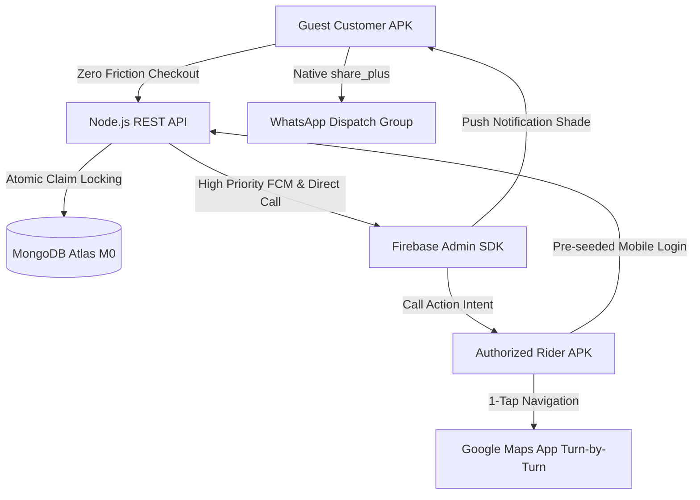

# Melapalayam Express (MPM) 🛵
### Hyper-Local Errand, Delivery, and Pickup-and-Drop Platform (Melapalayam, Tirunelveli)

---

## 🏗️ Architecture Overview



### 1. Guest Customer Checkout (Zero Friction)
- **Zero Login Friction:** No passwords or customer OTP barriers. Name and Primary Contact are stored once in `SharedPreferences` and auto-populated.
- **Top Bar Active Counter:** Real-time indicator displaying `🟢 X Riders Active in Melapalayam`.
- **Legal Warning Banner:** Prohibits cash, alcohol, narcotics, unprescribed medicines, and contraband with statutory warning.
- **Fare Engine:** ₹30 base (first 2 km), ₹10/km for distance beyond, +₹15 urgent toggle.
- **Native WhatsApp Group Dispatch:** Formatted order tickets dispatched directly to the WhatsApp dispatch group via `share_plus`.
- **Milestone-Based Tracking:** Placed ➔ Assigned ➔ Picked/Purchased ➔ On the Way ➔ Delivered. Locked cancellation once items are purchased.

### 2. Rider Workflow & Dashboard
- **Pre-Seeded Accounts:** Authorized friends' numbers pre-seeded into MongoDB.
- **Online/Offline Switch:** Real-time status toggle updating the customer active counter.
- **Atomic Order Locking:** Concurrent-safe order claiming via MongoDB `findOneAndUpdate({ _id, assignedRider: null })` preventing double-claiming.
- **Anti-Pocket-Touch Milestone Sliders:** Custom sliding swipe buttons (`SwipeButton`) preventing accidental touches while driving bikes.
- **1-Tap Google Maps Navigation:** Turn-by-turn navigation via `google.navigation:q=lat,lng`.
- **Delivery Verification:** 4-digit PIN verification with an emergency bypass mechanism.

### 3. Database Cost Optimization (MongoDB Atlas M0)
- Orders and Rider statistics are permanently indexed.
- Notifications use a **48-hour auto-purge TTL index** (`expireAfterSeconds: 172800`) to guarantee storage stays within the free 512 MB tier.

---

## 🚀 Getting Started

### 1. Backend Setup (Node.js & MongoDB Atlas)
```bash
cd backend
npm install

# Copy configuration
cp .env.example .env
# Edit .env with your MongoDB Atlas connection string and Firebase credentials

# Pre-seed authorized Melapalayam riders
npm run seed

# Start API Server (Runs on port 5000)
npm run dev
```

#### Pre-seeded Rider Numbers for Testing:
- `9876543210` (Mohamed Aslam)
- `9876543211` (Syed Ibrahim)
- `9876543212` (Abdul Rahman)
- `9876543213` (Sheik Dawood)

### 2. Flutter Mobile App Setup
```bash
cd melapalayam_express
flutter pub get
flutter run
```
*Note:* In `lib/config/constants.dart`, ensure `apiBaseUrl` points to your backend IP (e.g., `http://10.0.2.2:5000/api` for Android emulator or your local machine LAN IP `http://192.168.x.x:5000/api` for physical device testing).
